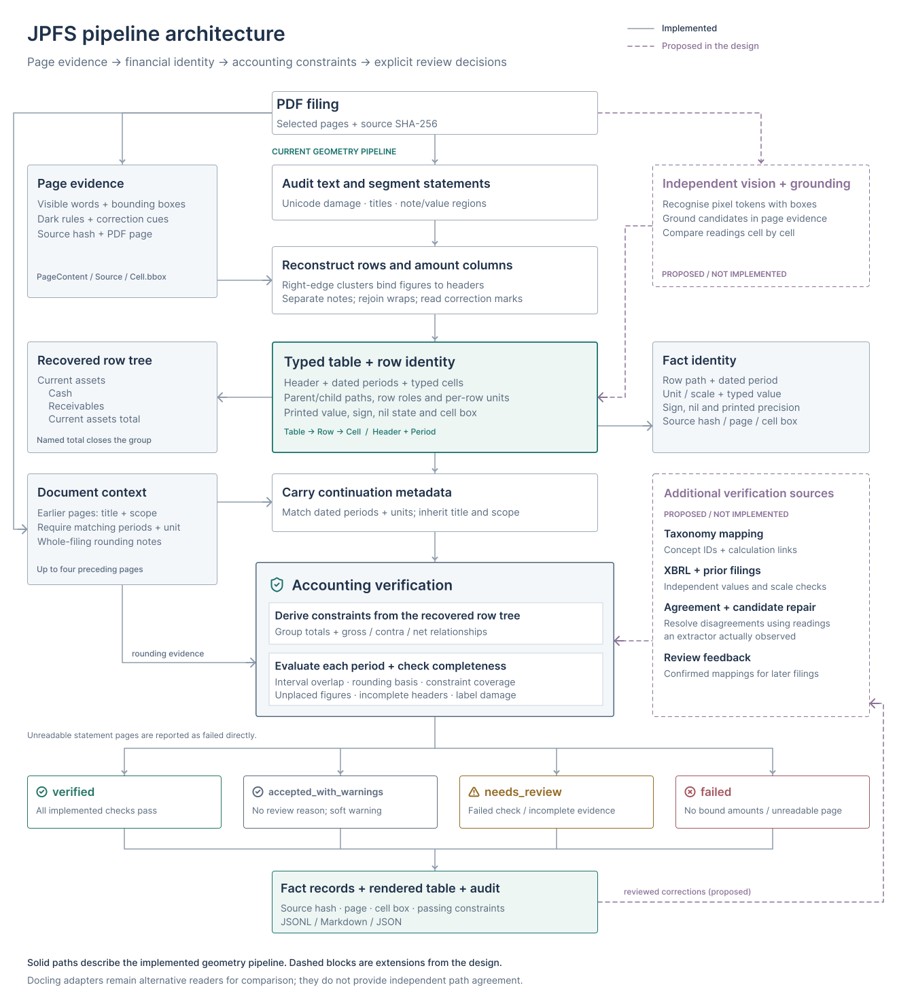

# jp-fs-parser

Parses Japanese financial-statement PDFs (決算短信, 有価証券報告書) into structured tables.
Each printed amount is tied to its row hierarchy, period, unit and sign. Accounting checks
report which tables can be accepted and which need review.

Three extraction engines are available. **Geometry is the default and performed best on the
49-page benchmark:** 94.73% strict fact F1 and 43 exact pages. The Docling engines are comparison
paths; passing their accounting checks does not guarantee correct labels or hierarchy.

The [pipeline design](#pipeline-design) below describes the current implementation. The
[engine comparison](docs/benchmark-engines.md) contains the complete results and failure cases.

## Pipeline design

The pipeline separates **reading the page** from **deciding whether to trust the result**.
Choose one extraction engine; its tables enter a common representation and the same checks.
There is no automatic fallback or agreement vote between engines.

[](docs/assets/pipeline.svg)

[Editable Figma source](https://www.figma.com/design/L0qkwSYvyNdRy4lzsIm9Xp?node-id=2-2)
· [Lucide icon license](docs/assets/LICENSE-lucide.txt)

### 1. Read the filing

Hash the source PDF, select its pages and retain the document text for context and rounding
notes. The geometry path audits the text layer and splits pages at statement titles. The two
Docling paths use layout detection to find tables.

| Reader | How it reconstructs a table |
|---|---|
| **Geometry · default** | Cluster right-aligned figures into columns; recover rows from text positions, indentation and vector rules; distinguish correction underlines from total rules. |
| **TableFormer** | Use Docling's layout detector and accurate table-structure model over the PDF text layer, with OCR disabled. |
| **GLM-OCR** | Use Docling to locate table crops, then read their pixels as HTML tables through MLX. PDF text supplies surrounding context and row indentation. |

### 2. Build typed facts and recover context

All readers produce the same `Table → Row → Cell` model. Values retain exact decimal
magnitudes, signs and the distinction between a blank, a dash and △0. Metadata records the
statement, consolidated scope, correction status, unit and dated periods. A row may use its
own unit, such as earnings per share in 円 inside a 百万円 statement.

Hierarchy comes from indentation and named closing totals, rather than company-specific
account lists. Geometry also rejoins supported wrapped labels. Continuation pages inherit
statement metadata only when their dated periods and units agree; assembly does not merge
cross-page arithmetic.

### 3. Verify before accepting

The verifier derives sum and gross-to-net constraints from the recovered tree. It compares
intervals of possible underlying values to allow for display rounding.
A printed rounding note takes precedence; otherwise a sign test may establish truncation.
Without enough evidence, checks use the hull of the rounding and truncation intervals and
record that uncertainty.

Acceptance also requires a statement title, unit, dated columns, constraint coverage and labels
without visible damage. Failed checks, unbound figures, uncovered cells or incomplete metadata
send a table to review. A clean-looking wrong label or an incorrect tree can still pass; the model
benchmarks demonstrate both failure modes.

| State | Meaning |
|---|---|
| `verified` | All implemented checks pass, with no review reasons or warnings. |
| `accepted_with_warnings` | No review reason remains, but a soft warning is recorded. |
| `needs_review` | A check fails or the available evidence is incomplete. |
| `failed` | No amount could be bound to a period, or the geometry path could not read a statement page. |

### 4. Export the result and its evidence

The CLI writes typed facts, a rendered Markdown table and the full audit record from the same
rows. Each fact includes its source PDF hash, page and passing constraints. Geometry retains
cell boxes and correction underlines; the model adapters currently retain less spatial
provenance. Review states remain visible in the exported records.

| Responsibility | Source |
|---|---|
| Document flow and continuation context | [`pipeline.py`](src/jpfs/pipeline.py), [`assembly.py`](src/jpfs/assembly.py) |
| Geometry and model adapters | [`layout.py`](src/jpfs/layout.py), [`engines/`](src/jpfs/engines/) |
| Typed model, lexical rules and hierarchy | [`model.py`](src/jpfs/model.py), [`text.py`](src/jpfs/text.py), [`structure.py`](src/jpfs/structure.py) |
| Constraints, state and export | [`checks.py`](src/jpfs/checks.py), [`verdict.py`](src/jpfs/verdict.py), [`render.py`](src/jpfs/render.py) |

## Quick start

Requires Python 3.12+ and [uv](https://docs.astral.sh/uv/). From the repository root:

```bash
uv sync --locked
uv run jpfs parse data/balance_sheet_p4.pdf -o out/geometry
uv run jpfs evaluate data/balance_sheet_p4.pdf data/balance_sheet_p4.gold.tsv
```

The included PDF is the original corrected balance-sheet sample. To parse your own filings:

```bash
uv run jpfs parse filing.pdf --pages 4,5 --engine geometry -o out/geometry
```

Page numbers are 1-based PDF positions. Omit `--pages` to process the whole document; pass
multiple PDF paths to process several filings.

### Choose an engine

| Engine | Table extraction | Requirements |
|---|---|---|
| `geometry` | PDF text positions, indentation and vector rules | Default installation; no model weights |
| `docling-tableformer` | Docling layout detection and TableFormer in accurate mode, using PDF text | `docling` extra; downloads model weights on first use |
| `docling-glmocr` | Docling table crops read by GLM-OCR; PDF text supplies context and indentation | `glmocr` extra; Apple silicon macOS, using MLX |

```bash
uv run --extra docling jpfs parse data/balance_sheet_p4.pdf \
  --engine docling-tableformer -o out/tableformer

uv run --extra glmocr jpfs parse data/balance_sheet_p4.pdf \
  --engine docling-glmocr -o out/glmocr
```

All three use the same typed table representation, hierarchy builder, cross-page assembly and
verifier. Engine selection is explicit; there is no automatic fallback. The GLM-OCR adapter
reads table contents from pixels but still depends on PDF text, so it is not a scan-only parser.
The implemented GLM-OCR backend supports Apple silicon only.

### Outputs

Each detected table produces three files under `<out>/<pdf-stem>/`:

| File | Content |
|---|---|
| `p<page>-<n>.facts.jsonl` | One fact per printed cell: row path, period, typed value, yen scale, source and verification |
| `p<page>-<n>.md` | Readable table and review reasons |
| `p<page>-<n>.json` | Full table record, accounting checks, uncovered cells and reasons |

States are `verified`, `accepted_with_warnings`, `needs_review` and `failed`. The first two are
counted as auto-accepted in the benchmark. They describe the checks performed, not a guarantee
that the extraction matches the PDF. The CLI exit code reports command errors; inspect the
exported states to decide which tables need review.

## Benchmark results

Measured on 27 October 2026: **49 pages, 2,765 gold facts, 16 issuers**, with the same frozen
annotations for every engine. All 12 engine/corpus runs completed.

| Engine | Strict fact F1 | Exact pages | Wrong / auto-accepted pages | Wrong / accepted facts |
|---|---:|---:|---:|---:|
| Geometry | **94.73%** | **43/49** | **0/15** | **0/866** |
| Docling + TableFormer | 90.47% | 33/49 | 1/15 | 36/752 |
| Docling + GLM-OCR | 76.61% | 5/49 | 11/13 | 42/682 |

These pooled scores include pages used to develop the parser and should be read as regression
results. The [latest holdout](docs/benchmark-holdout-2.md) was selected and annotated before its
first geometry run: on those 12 pages, geometry scores **99.51% strict fact F1 and 11/12 exact
pages**, versus 99.20% and 10/12 for TableFormer, and 78.30% and 1/12 for GLM-OCR in this comparison.
That holdout contains plainer earnings releases than the first holdout's annual reports.

Geometry accepted 15/49 pages. The rest need review or were marked `failed`. Zero wrong accepts
at this coverage does not establish a production error rate. TableFormer merged two valid headings on
one accepted page, changing 36 fact paths. GLM-OCR produced plausible but incorrect Japanese
labels while preserving amounts, so arithmetic still passed. These results compare the
implemented pipelines on the selected documents, not the underlying models in general.

The annotations were transcribed by one assistant and checked against rendered pages. They
have not been independently human-adjudicated or validated against XBRL. See the
[full comparison](docs/benchmark-engines.md) for per-corpus scores, model settings, report
snapshots and reproduction commands. Earlier measurements remain in the
[first batch](docs/benchmark.md), [expansion](docs/benchmark-expansion.md),
[first holdout](docs/benchmark-holdout.md) and [second holdout](docs/benchmark-holdout-2.md) reports.

### What is scored

- **Strict fact F1:** exact row path, period, column dimension, display unit and typed value.
  Duplicate predictions count against precision. Missing tables count against recall.
- **Flat fact F1:** the same key using only the leaf label, to distinguish hierarchy errors
  from other extraction errors.
- **Exact page:** every row path, fact and header matches, including statement title,
  consolidated scope, correction status, units and period labels/dates.
- **Wrong acceptance:** an auto-accepted page that is not exact, or an accepted fact that
  does not match the strict key.

A dash means a presented line with no balance; a blank means no presented value; △0 is a
negative amount below one display unit. These are different facts. Repeated labels such as
その他 are distinguished by their full paths.

### Reproduce

Print the comparison from the checked-in snapshots without downloading PDFs or model weights:

```bash
uv run python -m jpfs.evaluation.compare docs/benchmark-engines
```

Run the default engine on the latest holdout:

```bash
uv run python -m jpfs.evaluation.corpus --download --engine geometry \
  --manifest data/benchmark-holdout-2/manifest.json \
  --out out/engines/geometry/holdout-2
```

The runner downloads the public filings, checks their pinned SHA-256 values and writes page
records, rendered tables and `report.json`. Generated outputs and cached PDFs stay in `out/`,
which is ignored by Git. The [comparison guide](docs/benchmark-engines.md#reproduce) covers all
three engines and four corpora.

## Limitations

- Account-form layouts, equity matrices and some semantic groups remain unsupported. The
  Bank of Japan's two account-form pages score zero strict matches for every engine here.
- Cross-page assembly looks back up to four pages to recover metadata. It does not verify
  totals whose members span pages.
- Parent rows followed by breakdowns, unnamed subtotals and income-statement step-downs can
  produce incomplete or incorrect constraints, even when extracted values are correct.
- Label checks detect visible damage, not plausible substitutions. Wrong labels and hierarchy
  can pass verification, as the model runs demonstrate.
- TableFormer uses the text layer with OCR disabled. The GLM-OCR adapter also needs PDF text
  for context and indentation. A model can miss a table entirely; the benchmark still scores
  the selected page. Neither adapter preserves complete cell boxes or correction underlines.
- There is no taxonomy mapping, XBRL cross-check or agreement-based arbitration between engines.
  Scan-only accuracy and arbitrary financial tables have not been established.

## Development

```bash
uv sync --locked
uv run ruff check
uv run ruff format --check
uv run pytest -q
```

The tests are offline; they do not download filings or load model weights. The optional model
engines were exercised separately by the benchmark runs. The frozen annotations live in
`data/benchmark*/`; evaluation and comparison commands live in `src/jpfs/evaluation/`.

The [original design PDF](docs/design.pdf) is retained as background; the pipeline above is the
current design. The project [chat log](docs/chatlog.md) is also available.
